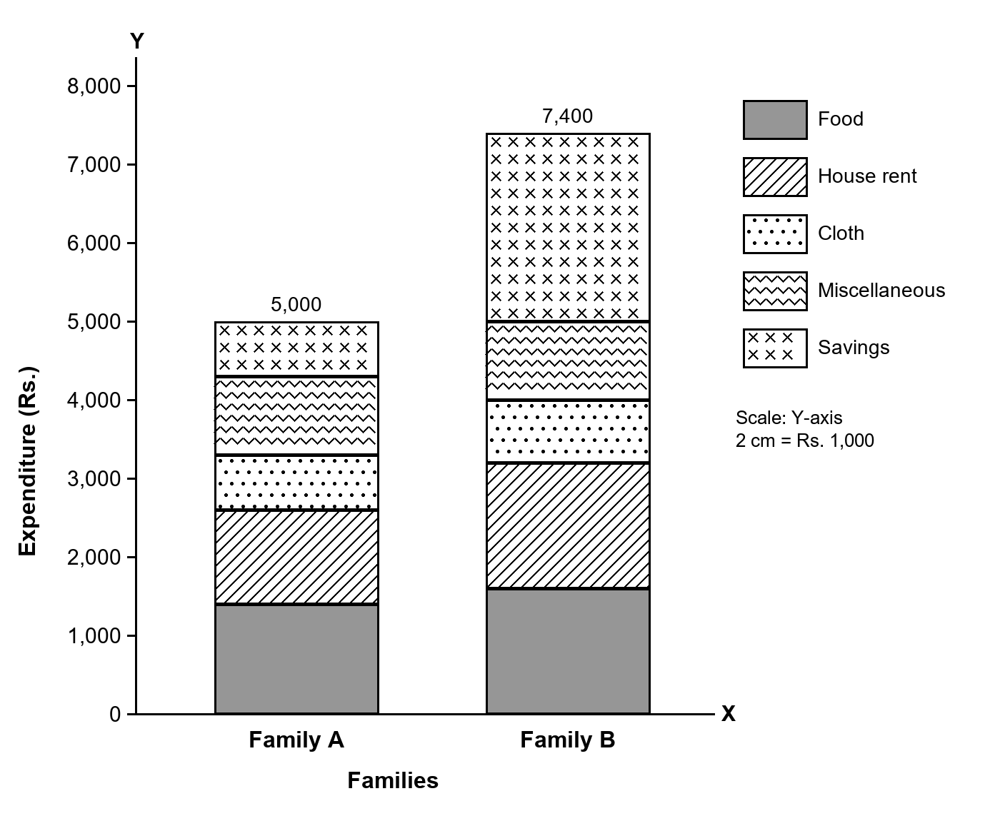

<!--
  Third Semester B.Com., December 2025 / January 2026 (SEP 2024-25), Davangere University.
  Business Statistics, Q.P. code 54322. Paper: papers/sem3-dec-2025-jan-2026/all-question-papers.pdf, pages 2-3.
  Choice rule: only the first N of each section. A: 1(a)-(j). B: Q2-Q9 (Q8, Q9 added 2026-11-10 from a friend's solved notes). C: Q10-Q12.
  Q4-Q12 follow the friend's methods (2026-11-10); his slips in Q10 median, Q11 rounding and Q12 x-squared are corrected.
  Q7: Σx², Σy², Σdxdy are read as deviation sums from the means (bxy = Σdxdy / Σdy²), the friend's method.
-->

# SECTION A – 2 MARKS

## Q1. (a)
**Statistics** is the science of collecting, presenting, analysing and interpreting numerical data. In the words of Croxton and Cowden, statistics may be defined as "the collection, presentation, analysis and interpretation of numerical data".

## Q1. (b)
1. **Primary data:** Data collected for the first time by the investigator himself, for a specific purpose. They are original in nature.
2. **Secondary data:** Data already collected by someone else and used by the investigator, such as published reports and records.

## Q1. (c)
**Tabulation** is the systematic arrangement of classified data in rows and columns. It presents a large mass of data in a compact and orderly form, so that it is easy to understand and compare.

## Q1. (d)
1. The sum of the deviations of the items from the arithmetic mean is always zero: Σ(x − x̄) = 0.
2. The sum of the squares of the deviations from the arithmetic mean is the least: Σ(x − x̄)² is a minimum.

## Q1. (e)
Largest value L = 100, smallest value S = 20.

Range = L − S = 100 − 20 = **80**.

Coefficient of range = (L − S) / (L + S) = 80 / 120 = **0.67**.

## Q1. (f)
**Standard deviation** is the square root of the arithmetic mean of the squared deviations of the items from their arithmetic mean. It is denoted by σ: σ = √(Σ(x − x̄)² / N). It is the most widely used measure of dispersion.

## Q1. (g)
**Correlation** is the relationship between two or more variables, such that a change in one variable is accompanied by a change in the other. For example, price and demand, or income and expenditure, are correlated.

## Q1. (h)
**Regression** is the statistical method of estimating the unknown value of one variable from the known value of another variable. It shows the average relationship between two variables in the form of an equation.

## Q1. (i)
**Classification** is the process of arranging the collected data into groups or classes according to their common characteristics, such as area, time, attribute or size.

## Q1. (j)
A **histogram** is a graph of a frequency distribution in which the class intervals are shown on the X-axis and the frequencies on the Y-axis. Each class is shown by a rectangle whose height is its frequency, and the rectangles are drawn next to one another.

# SECTION B – 5 MARKS

## Q2.
1. **Geographical classification:** Data are grouped by place or area, such as country, state, district or city, for example the population of each state.
2. **Chronological classification:** Data are grouped by time, such as years, months or weeks, for example the sales of a company year by year.
3. **Qualitative classification:** Data are grouped by an attribute that cannot be measured, such as sex, religion, literacy or occupation.
4. **Simple and manifold classification:** In simple classification data are divided by one attribute into two classes (for example literate and illiterate); in manifold classification they are divided by two or more attributes at a time.
5. **Quantitative classification:** Data are grouped by a characteristic that can be measured, such as height, weight, income or marks, using class intervals. Such a grouping is a frequency distribution.

## Q3.
1. **Direct personal investigation:** The investigator collects the information personally from the persons concerned. It suits a small, local enquiry and gives accurate data.
2. **Indirect oral investigation:** Information is collected from third persons (witnesses) who know the facts, as in enquiries by committees and commissions.
3. **Information through local correspondents:** Local agents or correspondents are appointed in different areas, and they send the information regularly, as newspapers do.
4. **Mailed questionnaire:** A list of questions is sent by post to the informants, who fill it in and return it. It covers a wide area at low cost.
5. **Schedules sent through enumerators:** Trained enumerators take the schedule to the informants, ask the questions and fill in the answers themselves, as in the census.

## Q4.
| x | f | cf |
|---|---|---|
| 20 | 25 | 25 |
| 60 | 48 | 73 |
| 80 | 60 | 133 |
| 100 | 57 | 190 |
| 120 | 29 | 219 |
| 140 | 10 | 229 |
| 160 | 8 | 237 |
| 200 | 2 | 239 |
| | **Σf = N = 239** | |

Q1 = size of [(N + 1) / 4]th item = (239 + 1) / 4 = 240 / 4 = 60th item. The 60th item falls in cf 73, so **Q1 = 60**.

Q3 = size of 3[(N + 1) / 4]th item = 3 (240 / 4) = 3 (60) = 180th item. The 180th item falls in cf 190, so **Q3 = 100**.

Quartile deviation = (Q3 − Q1) / 2 = (100 − 60) / 2 = 40 / 2 = **20**

Coefficient of QD = (Q3 − Q1) / (Q3 + Q1) = (100 − 60) / (100 + 60) = 40 / 160 = **0.25**

## Q5.
| x | log x |
|---|---|
| 20 | 1.3010 |
| 350 | 2.5441 |
| 450 | 2.6532 |
| 600 | 2.7782 |
| 861 | 2.9350 |
| 958 | 2.9814 |
| **n = 6** | **Σ log x = 15.1929** |

GM = Antilog (Σ log x / n) = Antilog (15.1929 / 6) = Antilog 2.5322

GM = 10^2.5322 = **340.52**

## Q6.
**Table showing the distribution of employees according to class, sex and salary grade**

| Salary (Rs.) | Sup. M | Sup. F | Asst. M | Asst. F | Clerk M | Clerk F | Total |
|---|---|---|---|---|---|---|---|
| Below 3,000 | | | | | | | |
| 3,000 – 5,000 | | | | | | | |
| 5,000 and above | | | | | | | |
| **Total** | | | | | | | |

Sup. = Supervisor, Asst. = Assistant, M = Male, F = Female. Each cell holds the number of employees.

**Source:** ............ **Note:** ............

## Q7.
N = 20, x̄ = 4, ȳ = 2, Σdx² = 1,680, Σdy² = 320, Σdxdy = 480

bxy = Σdxdy / Σdy² = 480 / 320 = **1.5**

byx = Σdxdy / Σdx² = 480 / 1,680 = 0.2857 ≈ **0.29**

### x on y
x − x̄ = bxy (y − ȳ)

x − 4 = 1.5 (y − 2)

x − 4 = 1.5y − 3

**x = 1.5y + 1**

### y on x
y − ȳ = byx (x − x̄)

y − 2 = 0.29 (x − 4)

y − 2 = 0.29x − 1.16

**y = 0.29x + 0.84**

### When y = 7
x = 1.5 (7) + 1 = 10.5 + 1 = **11.5**

## Q8.
| Item | Family A | Family B |
|---|---|---|
| Food | 1,400 | 1,600 |
| House rent | 1,200 | 1,600 |
| Cloth | 700 | 800 |
| Miscellaneous | 1,000 | 1,000 |
| Savings | 700 | 2,400 |
| **Total** | **5,000** | **7,400** |

## Q9.
**Frequency distribution of the given data**

| Class | Tally bars | Frequency |
|---|---|---|
| 0 – 10 | IIII | 4 |
| 10 – 20 | ~~IIII~~ III | 8 |
| 20 – 30 | ~~IIII~~ ~~IIII~~ | 10 |
| 30 – 40 | IIII | 4 |
| 40 – 50 | IIII | 4 |
| | **Total** | **30** |

# SECTION C – 10 MARKS

## Q10.
A = 14.5, c = 10, d' = (x − A) / c; exclusive classes (9.5 – 19.5 …) for the median.

| CI | f | x | d' | fd' | cf |
|---|---|---|---|---|---|
| 10 – 19 | 10 | 14.5 | 0 | 0 | 10 |
| 20 – 29 | 18 | 24.5 | 1 | 18 | 28 |
| 30 – 39 | 8 | 34.5 | 2 | 16 | 36 |
| 40 – 49 | 6 | 44.5 | 3 | 18 | 42 |
| 50 – 59 | 4 | 54.5 | 4 | 16 | 46 |
| 60 – 69 | 2 | 64.5 | 5 | 10 | 48 |
| 70 – 79 | 5 | 74.5 | 6 | 30 | 53 |
| 80 – 89 | 7 | 84.5 | 7 | 49 | 60 |
| | **N = 60** | | | **Σfd' = 157** | |

### Mean
x̄ = A + (Σfd' / N) × c = 14.5 + (157 / 60) × 10 = 14.5 + 2.6167 × 10 = 14.5 + 26.17 = **40.67**

### Median
m = N / 2 = 60 / 2 = 30th item → class 29.5 – 39.5 (cf 36).

L1 = 29.5, L2 = 39.5, f = 8, c (cf of the class before) = 28

Median = L1 + ((L2 − L1) / f) (m − c) = 29.5 + ((39.5 − 29.5) / 8) (30 − 28) = 29.5 + 1.25 (2) = 29.5 + 2.5 = **32**

### Mode
Z = 3M − 2x̄ = 3 (32) − 2 (40.67) = 96 − 81.33 = **14.67**

**Mean = 40.67, Median = 32, Mode = 14.67**

## Q11.
A = 15, c = 10, d' = (x − A) / c

| CI | f | x | d' | fd' | d'² | fd'² | fx |
|---|---|---|---|---|---|---|---|
| 10 – 20 | 10 | 15 | 0 | 0 | 0 | 0 | 150 |
| 20 – 30 | 18 | 25 | 1 | 18 | 1 | 18 | 450 |
| 30 – 40 | 20 | 35 | 2 | 40 | 4 | 80 | 700 |
| 40 – 50 | 6 | 45 | 3 | 18 | 9 | 54 | 270 |
| 50 – 60 | 4 | 55 | 4 | 16 | 16 | 64 | 220 |
| 60 – 70 | 2 | 65 | 5 | 10 | 25 | 50 | 130 |
| | **N = 60** | | | **Σfd' = 102** | | **Σfd'² = 266** | **Σfx = 1,920** |

### Standard deviation
σ = √(Σfd'² / N − (Σfd' / N)²) × c = √(266 / 60 − (102 / 60)²) × 10

σ = √(4.4333 − (1.7)²) × 10 = √(4.4333 − 2.89) × 10 = √1.5433 × 10 = 1.2423 × 10 = **12.42**

### Mean
x̄ = Σfx / N = 1,920 / 60 = **32**

### Coefficient of variation
CV = (σ / x̄) × 100 = (12.42 / 32) × 100 = 0.3882 × 100 = **38.82%**

## Q12.
x̄ = 141 / 8 = 17.6, ȳ = 286 / 8 = 35.7, x = X − x̄, y = Y − ȳ

| X | Y | x | y | xy | x² | y² |
|---|---|---|---|---|---|---|
| 8 | 25 | −9.6 | −10.7 | 102.72 | 92.16 | 114.49 |
| 10 | 30 | −7.6 | −5.7 | 43.32 | 57.76 | 32.49 |
| 15 | 32 | −2.6 | −3.7 | 9.62 | 6.76 | 13.69 |
| 17 | 35 | −0.6 | −0.7 | 0.42 | 0.36 | 0.49 |
| 20 | 37 | 2.4 | 1.3 | 3.12 | 5.76 | 1.69 |
| 22 | 40 | 4.4 | 4.3 | 18.92 | 19.36 | 18.49 |
| 24 | 42 | 6.4 | 6.3 | 40.32 | 40.96 | 39.69 |
| 25 | 45 | 7.4 | 9.3 | 68.82 | 54.76 | 86.49 |
| **141** | **286** | | | **Σxy = 287.26** | **Σx² = 277.88** | **Σy² = 307.52** |

### Coefficient of correlation
r = Σxy / √(Σx² × Σy²) = 287.26 / √(277.88 × 307.52) = 287.26 / √85,453.66 = 287.26 / 292.32 = **0.983**

### Probable error
PE = 0.6745 × (1 − r²) / √n = 0.6745 × (1 − 0.9657) / √8 = 0.6745 × 0.0343 / 2.828 = 0.6745 × 0.0121 = **0.0082**

**r = 0.983, PE = 0.0082.** Very high positive correlation; r > 6 PE, so it is significant.
