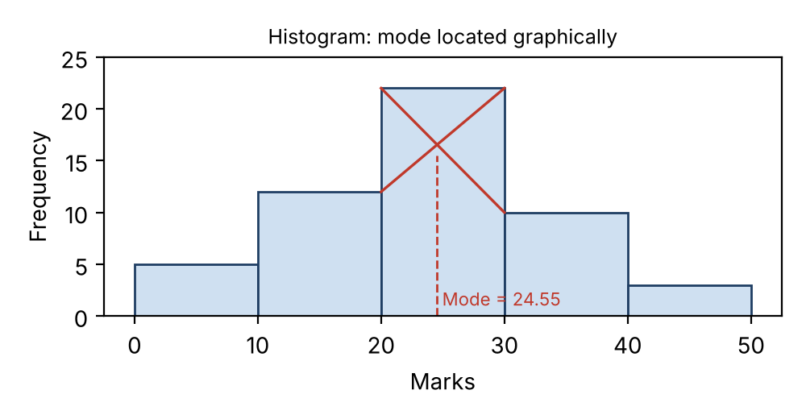
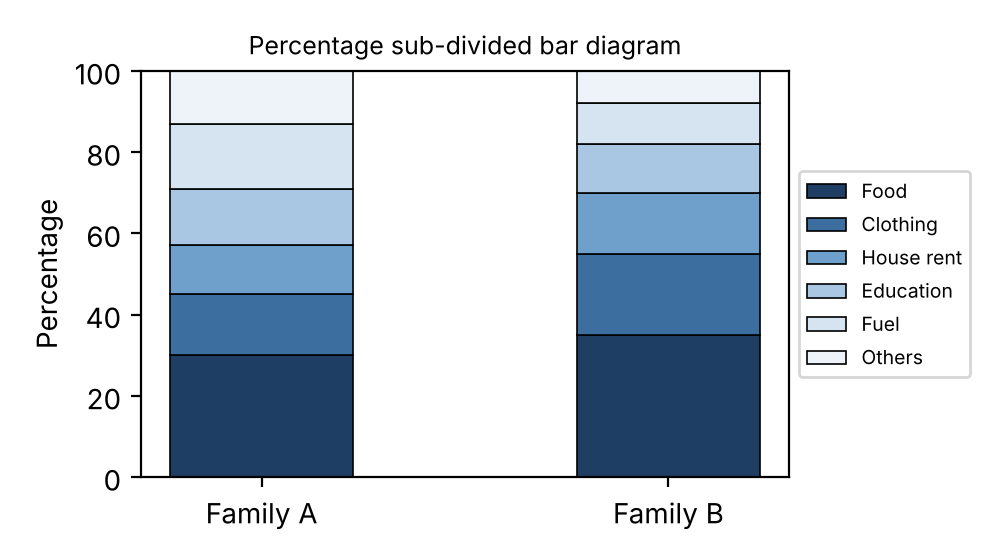

<!--
  Business Statistics (B.Com. 3), expected paper as last year's setter would set it, with an answer sheet.
  Made 23-11-2026. Single column only (his choice). Problems are taken from older papers the setter reuses; every figure computed and checked in a script.
-->

# BUSINESS STATISTICS — EXPECTED PAPER

How last year's setter works: simple, standard questions; the same layout every time (12 short, 8 medium, 5 long); a few problems copied with the same numbers from older papers (in 2025 he copied two); and topics he skipped last time come back. This paper follows those habits. The question paper comes first, then the answer sheet.

# QUESTION PAPER

**Third Semester B.Com. — Business Statistics.** Time: 3 hours. Max. marks: 80.

# SECTION A — answer any ten (10 × 2 = 20)

1. (a) Define statistics.

(b) What is primary data?

(c) What is secondary data?

(d) Define median.

(e) What is mode?

(f) Find the range and its coefficient: 65, 70, 82, 59, 81, 76, 57, 60, 55, 50.

(g) What is quartile deviation?

(h) Define coefficient of variation.

(i) What is an ogive?

(j) Mention the types of correlation.

(k) What is regression?

(l) What is probable error? Write its formula.

# SECTION B — answer any six (6 × 5 = 30)

**2.** Explain the functions and limitations of statistics.

**3.** Distinguish between primary data and secondary data.

**4.** Draw a blank table to show the number of students in a college according to (a) Gender: boys and girls; (b) Faculty: Arts, Commerce and Science; (c) Class: PUC and Degree.

**5.** Calculate the geometric mean and the harmonic mean of the following price relatives: 207, 198, 156, 124, 107, 196.

**6.** Calculate the median from the following data.

| Marks | 10 | 20 | 30 | 40 | 50 | 60 | 70 | 80 | 90 |
|---|---|---|---|---|---|---|---|---|---|
| No. of students | 3 | 5 | 9 | 3 | 2 | 3 | 5 | 10 | 10 |

**7.** Draw a histogram and locate the mode graphically. Verify the result by formula.

| Marks | 0–10 | 10–20 | 20–30 | 30–40 | 40–50 |
|---|---|---|---|---|---|
| Frequency | 5 | 12 | 22 | 10 | 3 |

**8.** From the following data, obtain the two regression equations and estimate Y when X = 90.

| Particulars | X | Y |
|---|---|---|
| Arithmetic mean | 80 | 110 |
| Standard deviation | 4 | 5 |

Coefficient of correlation r = 0.7.

**9.** Represent the following data by a percentage sub-divided bar diagram.

| Items | Family A (Rs.) | Family B (Rs.) |
|---|---|---|
| Food | 1,500 | 2,100 |
| Clothing | 750 | 1,200 |
| House rent | 600 | 900 |
| Education | 700 | 720 |
| Fuel | 800 | 600 |
| Others | 650 | 480 |
| Total | 5,000 | 6,000 |

# SECTION C — answer any three (3 × 10 = 30)

**10.** Compute the mean, median and mode from the following data.

| Marks | 0–10 | 10–20 | 20–30 | 30–40 | 40–50 | 50–60 | 60–70 | 70–80 | 80–90 | 90–100 |
|---|---|---|---|---|---|---|---|---|---|---|
| No. of students | 7 | 9 | 18 | 36 | 54 | 75 | 51 | 27 | 15 | 8 |

**11.** Which section is more consistent in scoring?

| Marks | 0–10 | 10–20 | 20–30 | 30–40 | 40–50 |
|---|---|---|---|---|---|
| Boys section | 9 | 13 | 20 | 10 | 8 |
| Girls section | 5 | 12 | 24 | 12 | 7 |

**12.** Calculate the coefficient of correlation between investment made and return obtained, taking 105 and 60 as the assumed means. Also calculate the probable error of r.

| Investment made | 105 | 111 | 104 | 112 | 118 | 98 | 116 | 103 | 116 | 112 |
|---|---|---|---|---|---|---|---|---|---|---|
| Return obtained | 62 | 64 | 53 | 60 | 72 | 56 | 68 | 60 | 69 | 65 |

**13.** Obtain the regression of Y on X and of X on Y. Estimate Y when X = 30.

| X | 25 | 28 | 35 | 32 | 36 | 29 | 32 | 38 | 34 | 32 |
|---|---|---|---|---|---|---|---|---|---|---|
| Y | 43 | 46 | 49 | 42 | 36 | 32 | 31 | 30 | 33 | 39 |

**14.** What is classification? Explain the objectives and types of classification.

# ANSWER SHEET

# SECTION A – 2 MARKS

## Q1. (a)
**Statistics** is the science of collecting, presenting, analysing and interpreting numerical data. In the words of Croxton and Cowden, statistics may be defined as "the collection, presentation, analysis and interpretation of numerical data".

## Q1. (b)
**Primary data** are data originally collected by the investigator or agency for the first time, for a particular statistical enquiry. They are original in nature and are collected at the source, for example through surveys and interviews.

## Q1. (c)
**Secondary data** are data already collected by someone else for some other purpose and only used by the investigator, for example the Economic Survey of India, published reports and records.

## Q1. (d)
The **median** is the middle value of a series arranged in ascending or descending order. It divides the series into two equal parts, so half the items lie below it and half above it.

## Q1. (e)
The **mode** is the value that occurs most frequently in a series, that is, the value around which the items are most heavily concentrated.

## Q1. (f)
Largest value L = 82, smallest value S = 50.

Range = L − S = 82 − 50 = **32**.

Coefficient of range = (L − S) / (L + S) = 32 / 132 = **0.24**.

## Q1. (g)
**Quartile deviation** is half the difference between the upper quartile and the lower quartile. QD = (Q3 − Q1) / 2. It is also called the semi-interquartile range; its coefficient is (Q3 − Q1) / (Q3 + Q1).

## Q1. (h)
The **coefficient of variation** is the standard deviation expressed as a percentage of the mean: CV = (σ / x̄) × 100. It is used to compare the consistency of two series; the series with the lower CV is more consistent.

## Q1. (i)
An **ogive** is a cumulative frequency curve. Cumulative frequencies are plotted against the class limits and joined by a smooth curve. There are two types, the less-than ogive and the more-than ogive, and the median can be located from them graphically.

## Q1. (j)
1. **Positive and negative correlation:** both variables move in the same direction (positive) or in opposite directions (negative).
2. **Simple, partial and multiple correlation; linear and non-linear correlation:** by the number of variables studied and by the constancy of the ratio of change.

## Q1. (k)
**Regression** is the statistical method of estimating the unknown value of one variable from the known value of another variable. It shows the average relationship between two variables in the form of an equation.

## Q1. (l)
The **probable error** tests the reliability of the coefficient of correlation. PE = 0.6745 × (1 − r²) / √N. If r is more than 6 times PE, the correlation is significant.

# SECTION B – 5 MARKS

## Q2.
### Functions
1. **To present facts in numerical figures and in a simplified form:** a large mass of complex data is condensed into totals, averages and percentages that are easy to understand.
2. **To provide comparison and study relationships:** facts are compared through averages, ratios and coefficients, and relationships such as demand and price are measured by correlation.
3. **To help in forecasting and policy-making:** past figures are used to forecast future trends and to frame policies of government and business.
### Limitations
4. **Statistics deals only with numerical facts and with groups, not individuals:** qualities such as honesty cannot be studied directly, and the results apply to a group, not to a single person.
5. **Results are only approximately true and can be misused:** statistical laws are true only on average, and in unskilled or dishonest hands figures can be twisted to mislead; statistics should be used only by experts.

## Q3.
| Basis | Primary data | Secondary data |
|---|---|---|
| Meaning | Collected for the first time by the investigator | Already collected by someone else |
| Originality | Original in character | Not original; second-hand |
| Cost and time | Needs more money, time and labour | Cheap and quick to obtain |
| Accuracy | More accurate and reliable for the purpose | May not suit the purpose; must be used with care |
| Source | Surveys, interviews, questionnaires | Published reports, records, government publications |

## Q4.
**Table showing the number of students in a college according to gender, faculty and class**

| Faculty | PUC Boys | PUC Girls | PUC Total | Degree Boys | Degree Girls | Degree Total | Total |
|---|---|---|---|---|---|---|---|
| Arts | | | | | | | |
| Commerce | | | | | | | |
| Science | | | | | | | |
| **Total** | | | | | | | |

**Source:** ............ **Note:** ............

## Q5.
| x | log x | 1/x |
|---|---|---|
| 207 | 2.3160 | 0.00483 |
| 198 | 2.2967 | 0.00505 |
| 156 | 2.1931 | 0.00641 |
| 124 | 2.0934 | 0.00806 |
| 107 | 2.0294 | 0.00935 |
| 196 | 2.2923 | 0.00510 |
| **n = 6** | **Σ log x = 13.2209** | **Σ 1/x = 0.03880** |

**GM** = Antilog (Σ log x / n) = Antilog (13.2209 / 6) = Antilog 2.2035 = **159.77**

**HM** = n / Σ(1/x) = 6 / 0.03880 = **154.64**

## Q6.
| Marks (x) | f | cf |
|---|---|---|
| 10 | 3 | 3 |
| 20 | 5 | 8 |
| 30 | 9 | 17 |
| 40 | 3 | 20 |
| 50 | 2 | 22 |
| 60 | 3 | 25 |
| 70 | 5 | 30 |
| 80 | 10 | 40 |
| 90 | 10 | 50 |
| | **N = 50** | |

Median = size of (N + 1) / 2 th item = 51 / 2 = 25.5th item.

The 25.5th item falls in cf 30 (the 25th item ends at cf 25), so **Median = 70 marks**.

## Q7.

**Graphically:** the modal class is 20–30 (highest bar). Join the top-right corner of the modal bar to the top-right corner of the bar before it, and the top-left corner of the modal bar to the top-left corner of the bar after it. From the point where the two lines cross, drop a perpendicular to the X-axis; it meets the axis at the mode.

**By formula:** L1 = 20, f1 = 22, f0 = 12, f2 = 10, i = 10.

Mode = L1 + (f1 − f0) / (2f1 − f0 − f2) × i = 20 + (22 − 12) / (44 − 12 − 10) × 10 = 20 + 10/22 × 10 = **24.55 marks**.

## Q8.
byx = r × σy / σx = 0.7 × 5 / 4 = **0.875**;  bxy = r × σx / σy = 0.7 × 4 / 5 = **0.56**

### Y on X
Y − Ȳ = byx (X − X̄) → Y − 110 = 0.875 (X − 80) → **Y = 0.875X + 40**

### X on Y
X − X̄ = bxy (Y − Ȳ) → X − 80 = 0.56 (Y − 110) → **X = 0.56Y + 18.4**

### When X = 90
Y = 0.875 (90) + 40 = **118.75**

## Q9.
| Items | Family A (Rs.) | % | Cum. % | Family B (Rs.) | % | Cum. % |
|---|---|---|---|---|---|---|
| Food | 1,500 | 30 | 30 | 2,100 | 35 | 35 |
| Clothing | 750 | 15 | 45 | 1,200 | 20 | 55 |
| House rent | 600 | 12 | 57 | 900 | 15 | 70 |
| Education | 700 | 14 | 71 | 720 | 12 | 82 |
| Fuel | 800 | 16 | 87 | 600 | 10 | 92 |
| Others | 650 | 13 | 100 | 480 | 8 | 100 |
| **Total** | **5,000** | **100** | | **6,000** | **100** | |

Each family's total is taken as 100 and each item is shown as its percentage (Food: 1,500 / 5,000 × 100 = 30%). The bars are of equal height (100%), divided by the cumulative percentages.

# SECTION C – 10 MARKS

## Q10.
A = 55, c = 10, d' = (x − A) / c

| Marks | f | x | d' | fd' | cf |
|---|---|---|---|---|---|
| 0–10 | 7 | 5 | -5 | -35 | 7 |
| 10–20 | 9 | 15 | -4 | -36 | 16 |
| 20–30 | 18 | 25 | -3 | -54 | 34 |
| 30–40 | 36 | 35 | -2 | -72 | 70 |
| 40–50 | 54 | 45 | -1 | -54 | 124 |
| 50–60 | 75 | 55 | 0 | 0 | 199 |
| 60–70 | 51 | 65 | 1 | 51 | 250 |
| 70–80 | 27 | 75 | 2 | 54 | 277 |
| 80–90 | 15 | 85 | 3 | 45 | 292 |
| 90–100 | 8 | 95 | 4 | 32 | 300 |
| | **N = 300** | | | **Σfd' = -69** | |

### Mean
x̄ = A + (Σfd' / N) × c = 55 + (-69 / 300) × 10 = **52.70**

### Median
m = N / 2 = 300 / 2 = 150th item → class 50–60 (cf 199).

L1 = 50, L2 = 60, f = 75, c (cf of the class before) = 124

Median = L1 + ((L2 − L1) / f) (m − c) = 50 + (10 / 75) (150 − 124) = **53.47**

### Mode
Modal class 50–60: f1 = 75, f0 = 54, f2 = 51.

Mode = L1 + (f1 − f0) / (2f1 − f0 − f2) × c = 50 + (75 − 54) / (150 − 54 − 51) × 10 = 50 + 21/45 × 10 = **54.67**

**Mean = 52.70, Median = 53.47, Mode = 54.67**

## Q11.
A = 25, c = 10, d' = (x − A) / c. The section with the lower coefficient of variation is more consistent.

| Marks | x | d' | Boys f | fd' | fd'² | Girls f | fd' | fd'² |
|---|---|---|---|---|---|---|---|---|
| 0–10 | 5 | -2 | 9 | -18 | 36 | 5 | -10 | 20 |
| 10–20 | 15 | -1 | 13 | -13 | 13 | 12 | -12 | 12 |
| 20–30 | 25 | 0 | 20 | 0 | 0 | 24 | 0 | 0 |
| 30–40 | 35 | 1 | 10 | 10 | 10 | 12 | 12 | 12 |
| 40–50 | 45 | 2 | 8 | 16 | 32 | 7 | 14 | 28 |
| | | | **60** | **-5** | **91** | **60** | **4** | **72** |

### Boys section
x̄ = 25 + (-5 / 60) × 10 = **24.17**

σ = √(Σfd'² / N − (Σfd' / N)²) × c = √(91 / 60 − (-5 / 60)²) × 10 = **12.29**

CV = (σ / x̄) × 100 = (12.29 / 24.17) × 100 = **50.84%**

### Girls section
x̄ = 25 + (4 / 60) × 10 = **25.67**

σ = √(72 / 60 − (4 / 60)²) × 10 = **10.93**

CV = (10.93 / 25.67) × 100 = **42.60%**

The CV of the girls section (42.60%) is lower than that of the boys section (50.84%). **The girls section is more consistent in scoring.**

## Q12.
dx = X − 105, dy = Y − 60 (assumed means).

| X | Y | dx | dy | dx² | dy² | dxdy |
|---|---|---|---|---|---|---|
| 105 | 62 | 0 | 2 | 0 | 4 | 0 |
| 111 | 64 | 6 | 4 | 36 | 16 | 24 |
| 104 | 53 | -1 | -7 | 1 | 49 | 7 |
| 112 | 60 | 7 | 0 | 49 | 0 | 0 |
| 118 | 72 | 13 | 12 | 169 | 144 | 156 |
| 98 | 56 | -7 | -4 | 49 | 16 | 28 |
| 116 | 68 | 11 | 8 | 121 | 64 | 88 |
| 103 | 60 | -2 | 0 | 4 | 0 | 0 |
| 116 | 69 | 11 | 9 | 121 | 81 | 99 |
| 112 | 65 | 7 | 5 | 49 | 25 | 35 |
| | | **45** | **29** | **599** | **399** | **437** |

### Coefficient of correlation
r = [Σdxdy − (Σdx × Σdy) / N] / √{[Σdx² − (Σdx)² / N] × [Σdy² − (Σdy)² / N]}

r = [437 − (45 × 29) / 10] / √{[599 − 45² / 10] × [399 − 29² / 10]}

r = 306.50 / √(396.50 × 314.90) = 306.50 / 353.35 = **0.867**

### Probable error
PE = 0.6745 × (1 − r²) / √N = 0.6745 × (1 − 0.7524) / √10 = 0.6745 × 0.2476 / 3.162 = **0.0528**

**r = 0.867, PE = 0.0528.** High positive correlation; r (0.867) is more than 6 PE (0.3169), so it is significant.

## Q13.
X̄ = ΣX / N = 321 / 10 = 32.1, Ȳ = ΣY / N = 381 / 10 = 38.1; x = X − X̄, y = Y − Ȳ

| X | Y | x | y | xy | x² | y² |
|---|---|---|---|---|---|---|
| 25 | 43 | -7.1 | 4.9 | -34.79 | 50.41 | 24.01 |
| 28 | 46 | -4.1 | 7.9 | -32.39 | 16.81 | 62.41 |
| 35 | 49 | 2.9 | 10.9 | 31.61 | 8.41 | 118.81 |
| 32 | 42 | -0.1 | 3.9 | -0.39 | 0.01 | 15.21 |
| 36 | 36 | 3.9 | -2.1 | -8.19 | 15.21 | 4.41 |
| 29 | 32 | -3.1 | -6.1 | 18.91 | 9.61 | 37.21 |
| 32 | 31 | -0.1 | -7.1 | 0.71 | 0.01 | 50.41 |
| 38 | 30 | 5.9 | -8.1 | -47.79 | 34.81 | 65.61 |
| 34 | 33 | 1.9 | -5.1 | -9.69 | 3.61 | 26.01 |
| 32 | 39 | -0.1 | 0.9 | -0.09 | 0.01 | 0.81 |
| **321** | **381** | | | **-82.10** | **138.90** | **404.90** |

byx = Σxy / Σx² = -82.10 / 138.90 = **-0.5911**;  bxy = Σxy / Σy² = -82.10 / 404.90 = **-0.2028**

### Y on X
Y − 38.1 = -0.5911 (X − 32.1) → **Y = -0.5911X + 57.07**

### X on Y
X − 32.1 = -0.2028 (Y − 38.1) → **X = -0.2028Y + 39.83**

### When X = 30
Y = -0.5911 (30) + 57.07 = **39.34**

## Q14.
### Meaning and objectives
1. **Meaning:** Classification is the process of dividing the data into groups or classes which are homogeneous within but different between themselves, according to some common characteristic.
2. **To condense the data:** a large mass of raw data is reduced to a few groups, so it is easy to understand.
3. **To bring out similarities and differences:** items with the same characteristic are placed together and separated from the others.
4. **To make comparison easy:** grouped data of two places or two periods can be compared directly.
5. **To help statistical analysis and tabulation:** classification is the basis for tabulation and for calculating averages, dispersion and correlation.
### Types (bases) of classification
6. **Geographical classification:** by place or region, such as states, districts or cities (for example sales in Karnataka, Tamil Nadu and Kerala).
7. **Chronological classification:** by time, such as years, months or weeks (for example the sales of a company year by year).
8. **Qualitative — simple classification:** by one attribute that cannot be measured, dividing the data into two classes (for example male and female).
9. **Qualitative — manifold classification:** by two or more attributes at a time (for example population → male/female → married/unmarried → literate/illiterate).
10. **Quantitative classification:** by a measurable characteristic such as height, weight, income or marks, using class intervals; such a grouping is a frequency distribution.
