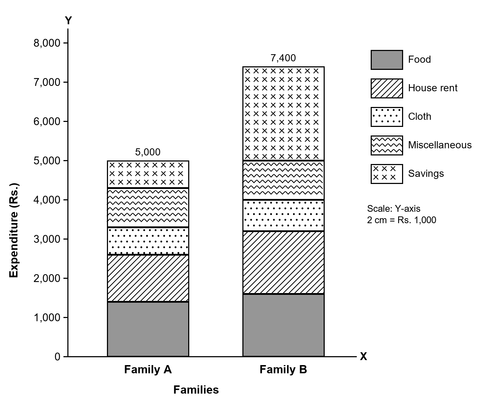
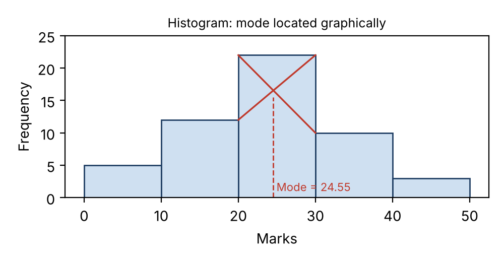
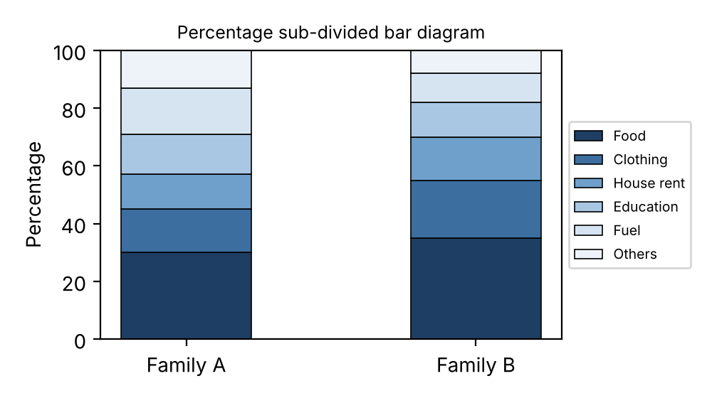

<!--
  Business Statistics Predicted Questions: answer sheet (important and predicted questions). Made 24-11-2026. Short answers: heading + one line per point.
-->

# BUSINESS STATISTICS PREDICTED QUESTIONS — ANSWERS

# 2 MARKS

## Q1. Define statistics.
**Statistics** is the science of collecting, presenting, analysing and interpreting numerical data. In the words of Croxton and Cowden, statistics may be defined as "the collection, presentation, analysis and interpretation of numerical data".

## Q2. Mention the types of collection of data.
1. **Primary data:** Data collected for the first time by the investigator himself, for a specific purpose. They are original in nature.
2. **Secondary data:** Data already collected by someone else and used by the investigator, such as published reports and records.

## Q3. What is tabulation?
**Tabulation** is the systematic arrangement of classified data in rows and columns. It presents a large mass of data in a compact and orderly form, so that it is easy to understand and compare.

## Q4. Mention two properties of the arithmetic mean.
1. The sum of the deviations of the items from the arithmetic mean is always zero: Σ(x − x̄) = 0.
2. The sum of the squares of the deviations from the arithmetic mean is the least: Σ(x − x̄)² is a minimum.

## Q5. Find the range and its coefficient: 20, 25, 80, 44, 96, 100.
Largest value L = 100, smallest value S = 20.

Range = L − S = 100 − 20 = **80**.

Coefficient of range = (L − S) / (L + S) = 80 / 120 = **0.67**.

## Q6. Define standard deviation.
**Standard deviation** is the square root of the arithmetic mean of the squared deviations of the items from their arithmetic mean. It is denoted by σ: σ = √(Σ(x − x̄)² / N). It is the most widely used measure of dispersion.

## Q7. Define correlation.
**Correlation** is the relationship between two or more variables, such that a change in one variable is accompanied by a change in the other. For example, price and demand, or income and expenditure, are correlated.

## Q8. What is regression?
**Regression** is the statistical method of estimating the unknown value of one variable from the known value of another variable. It shows the average relationship between two variables in the form of an equation.

## Q9. What is classification?
**Classification** is the process of arranging the collected data into groups or classes according to their common characteristics, such as area, time, attribute or size.

## Q10. Give the meaning of a histogram.
A **histogram** is a graph of a frequency distribution in which the class intervals are shown on the X-axis and the frequencies on the Y-axis. Each class is shown by a rectangle whose height is its frequency, and the rectangles are drawn next to one another.

## Q11. State any two differences between correlation and regression.
| Basis | Correlation | Regression |
|---|---|---|
| Meaning | Measures the degree and direction of relationship between two variables. | Estimates the value of one variable from the other. |
| Variables | No dependent or independent variable. | One variable is dependent, the other independent. |

## Q12. Write the formula of probable error.
**Probable error** of the coefficient of correlation: **P.E. = 0.6745 × (1 − r²) ÷ √N**, where r is the coefficient of correlation and N the number of pairs.

## Q13. What is primary data?
**Primary data** are data originally collected by the investigator or agency for the first time, for a particular statistical enquiry. They are original in nature and are collected at the source, for example through surveys and interviews.

## Q14. What is secondary data?
**Secondary data** are data already collected by someone else for some other purpose and only used by the investigator, for example the Economic Survey of India, published reports and records.

## Q15. Define median.
The **median** is the middle value of a series arranged in ascending or descending order. It divides the series into two equal parts, so half the items lie below it and half above it.

## Q16. What is mode?
The **mode** is the value that occurs most frequently in a series, that is, the value around which the items are most heavily concentrated.

## Q17. Find the range and its coefficient: 65, 70, 82, 59, 81, 76, 57, 60, 55, 50.
Largest value L = 82, smallest value S = 50.

Range = L − S = 82 − 50 = **32**.

Coefficient of range = (L − S) / (L + S) = 32 / 132 = **0.24**.

## Q18. What is quartile deviation?
**Quartile deviation** is half the difference between the upper quartile and the lower quartile. QD = (Q3 − Q1) / 2. It is also called the semi-interquartile range; its coefficient is (Q3 − Q1) / (Q3 + Q1).

## Q19. Define coefficient of variation.
The **coefficient of variation** is the standard deviation expressed as a percentage of the mean: CV = (σ / x̄) × 100. It is used to compare the consistency of two series; the series with the lower CV is more consistent.

## Q20. What is an ogive?
An **ogive** is a cumulative frequency curve. Cumulative frequencies are plotted against the class limits and joined by a smooth curve. There are two types, the less-than ogive and the more-than ogive, and the median can be located from them graphically.

## Q21. Mention the types of correlation.
1. **Positive and negative correlation:** both variables move in the same direction (positive) or in opposite directions (negative).
2. **Simple, partial and multiple correlation; linear and non-linear correlation:** by the number of variables studied and by the constancy of the ratio of change.

## Q22. What is probable error? Write its formula.
The **probable error** tests the reliability of the coefficient of correlation. PE = 0.6745 × (1 − r²) / √N. If r is more than 6 times PE, the correlation is significant.

# 5 MARKS

## Q23. Briefly explain the types of classification.
1. **Geographical classification:** Data are grouped by place or area, such as country, state, district or city, for example the population of each state.
2. **Chronological classification:** Data are grouped by time, such as years, months or weeks, for example the sales of a company year by year.
3. **Qualitative classification:** Data are grouped by an attribute that cannot be measured, such as sex, religion, literacy or occupation.
4. **Simple and manifold classification:** In simple classification data are divided by one attribute into two classes (for example literate and illiterate).
5. **Quantitative classification:** Data are grouped by a characteristic that can be measured, such as height, weight, income or marks, using class intervals.

## Q24. Briefly explain the different methods of collecting primary data.
1. **Direct personal investigation:** The investigator collects the information personally from the persons concerned.
2. **Indirect oral investigation:** Information is collected from third persons (witnesses) who know the facts, as in enquiries by committees and commissions.
3. **Information through local correspondents:** Local agents or correspondents are appointed in different areas, and they send the information regularly, as newspapers do.
4. **Mailed questionnaire:** A list of questions is sent by post to the informants, who fill it in and return it.
5. **Schedules sent through enumerators:** Trained enumerators take the schedule to the informants, ask the questions and fill in the answers themselves, as in the census.

## Q25. Calculate the quartile deviation and its coefficient.
| x | f | cf |
|---|---|---|
| 20 | 25 | 25 |
| 60 | 48 | 73 |
| 80 | 60 | 133 |
| 100 | 57 | 190 |
| 120 | 29 | 219 |
| 140 | 10 | 229 |
| 160 | 8 | 237 |
| 200 | 2 | 239 |
| | **Σf = N = 239** | |

Q1 = size of [(N + 1) / 4]th item = (239 + 1) / 4 = 240 / 4 = 60th item. The 60th item falls in cf 73, so **Q1 = 60**.

Q3 = size of 3[(N + 1) / 4]th item = 3 (240 / 4) = 3 (60) = 180th item. The 180th item falls in cf 190, so **Q3 = 100**.

Quartile deviation = (Q3 − Q1) / 2 = (100 − 60) / 2 = 40 / 2 = **20**

Coefficient of QD = (Q3 − Q1) / (Q3 + Q1) = (100 − 60) / (100 + 60) = 40 / 160 = **0.25**

## Q26. Find the geometric mean. x: 20, 350, 450, 600, 861, 958.
| x | log x |
|---|---|
| 20 | 1.3010 |
| 350 | 2.5441 |
| 450 | 2.6532 |
| 600 | 2.7782 |
| 861 | 2.9350 |
| 958 | 2.9814 |
| **n = 6** | **Σ log x = 15.1929** |

GM = Antilog (Σ log x / n) = Antilog (15.1929 / 6) = Antilog 2.5322

GM = 10^2.5322 = **340.52**

## Q27. Blank table: employees by sex, salary grade and designation.
**Table showing the distribution of employees according to class, sex and salary grade**

| Salary (Rs.) | Sup. M | Sup. F | Asst. M | Asst. F | Clerk M | Clerk F | Total |
|---|---|---|---|---|---|---|---|
| Below 3,000 | | | | | | | |
| 3,000 – 5,000 | | | | | | | |
| 5,000 and above | | | | | | | |
| **Total** | | | | | | | |

Sup. = Supervisor, Asst. = Assistant, M = Male, F = Female. Each cell holds the number of employees.

**Source:** ............ **Note:** ............

## Q28. Two regression equations; predict x when y = 7 (N = 20).
N = 20, x̄ = 4, ȳ = 2, Σdx² = 1,680, Σdy² = 320, Σdxdy = 480

bxy = Σdxdy / Σdy² = 480 / 320 = **1.5**

byx = Σdxdy / Σdx² = 480 / 1,680 = 0.2857 ≈ **0.29**

### x on y
x − x̄ = bxy (y − ȳ)

x − 4 = 1.5 (y − 2)

x − 4 = 1.5y − 3

**x = 1.5y + 1**

### y on x
y − ȳ = byx (x − x̄)

y − 2 = 0.29 (x − 4)

y − 2 = 0.29x − 1.16

**y = 0.29x + 0.84**

### When y = 7
x = 1.5 (7) + 1 = 10.5 + 1 = **11.5**

## Q29. Prepare a subdivided bar diagram.
| Item | Family A | Family B |
|---|---|---|
| Food | 1,400 | 1,600 |
| House rent | 1,200 | 1,600 |
| Cloth | 700 | 800 |
| Miscellaneous | 1,000 | 1,000 |
| Savings | 700 | 2,400 |
| **Total** | **5,000** | **7,400** |

## Q30. Construct a frequency distribution with class intervals 0–10, 10–20, and so on.
**Frequency distribution of the given data**

| Class | Tally bars | Frequency |
|---|---|---|
| 0 – 10 | IIII | 4 |
| 10 – 20 | ~~IIII~~ III | 8 |
| 20 – 30 | ~~IIII~~ ~~IIII~~ | 10 |
| 30 – 40 | IIII | 4 |
| 40 – 50 | IIII | 4 |
| | **Total** | **30** |

## Q31. Explain the functions and limitations of statistics.
### Functions
1. **To present facts in numerical figures and in a simplified form:** a large mass of complex data is condensed into totals, averages and percentages that are easy to understand.
2. **To provide comparison and study relationships:** facts are compared through averages, ratios and coefficients, and relationships such as demand and price are measured by correlation.
3. **To help in forecasting and policy-making:** past figures are used to forecast future trends and to frame policies of government and business.
### Limitations
4. **Statistics deals only with numerical facts and with groups, not individuals:** qualities such as honesty cannot be studied directly, and the results apply to a group, not to a single person.
5. **Results are only approximately true and can be misused:** statistical laws are true only on average, and in unskilled or dishonest hands figures can be twisted to mislead.

## Q32. Distinguish between primary data and secondary data.
| Basis | Primary data | Secondary data |
|---|---|---|
| Meaning | Collected for the first time by the investigator | Already collected by someone else |
| Originality | Original in character | Not original; second-hand |
| Cost and time | Needs more money, time and labour | Cheap and quick to obtain |
| Accuracy | More accurate and reliable for the purpose | May not suit the purpose; must be used with care |
| Source | Surveys, interviews, questionnaires | Published reports, records, government publications |

## Q33. Blank table: students by gender, faculty and class.
**Table showing the number of students in a college according to gender, faculty and class**

| Faculty | PUC Boys | PUC Girls | PUC Total | Degree Boys | Degree Girls | Degree Total | Total |
|---|---|---|---|---|---|---|---|
| Arts | | | | | | | |
| Commerce | | | | | | | |
| Science | | | | | | | |
| **Total** | | | | | | | |

**Source:** ............ **Note:** ............

## Q34. Geometric mean and harmonic mean of price relatives.
| x | log x | 1/x |
|---|---|---|
| 207 | 2.3160 | 0.00483 |
| 198 | 2.2967 | 0.00505 |
| 156 | 2.1931 | 0.00641 |
| 124 | 2.0934 | 0.00806 |
| 107 | 2.0294 | 0.00935 |
| 196 | 2.2923 | 0.00510 |
| **n = 6** | **Σ log x = 13.2209** | **Σ 1/x = 0.03880** |

**GM** = Antilog (Σ log x / n) = Antilog (13.2209 / 6) = Antilog 2.2035 = **159.77**

**HM** = n / Σ(1/x) = 6 / 0.03880 = **154.64**

## Q35. Calculate the median from the following data.
| Marks (x) | f | cf |
|---|---|---|
| 10 | 3 | 3 |
| 20 | 5 | 8 |
| 30 | 9 | 17 |
| 40 | 3 | 20 |
| 50 | 2 | 22 |
| 60 | 3 | 25 |
| 70 | 5 | 30 |
| 80 | 10 | 40 |
| 90 | 10 | 50 |
| | **N = 50** | |

Median = size of (N + 1) / 2 th item = 51 / 2 = 25.5th item.

The 25.5th item falls in cf 30 (the 25th item ends at cf 25), so **Median = 70 marks**.

## Q36. Draw a histogram and locate the mode graphically. Verify the result by formula.

**Graphically:** the modal class is 20–30 (highest bar). Join the top-right corner of the modal bar to the top-right corner of the bar before it, and the top-left corner of the modal bar to the top-left corner of the bar after it. From the point where the two lines cross, drop a perpendicular to the X-axis; it meets the axis at the mode.

**By formula:** L1 = 20, f1 = 22, f0 = 12, f2 = 10, i = 10.

Mode = L1 + (f1 − f0) / (2f1 − f0 − f2) × i = 20 + (22 − 12) / (44 − 12 − 10) × 10 = 20 + 10/22 × 10 = **24.55 marks**.

## Q37. Two regression equations; estimate Y when X = 90.
byx = r × σy / σx = 0.7 × 5 / 4 = **0.875**;  bxy = r × σx / σy = 0.7 × 4 / 5 = **0.56**

### Y on X
Y − Ȳ = byx (X − X̄) → Y − 110 = 0.875 (X − 80) → **Y = 0.875X + 40**

### X on Y
X − X̄ = bxy (Y − Ȳ) → X − 80 = 0.56 (Y − 110) → **X = 0.56Y + 18.4**

### When X = 90
Y = 0.875 (90) + 40 = **118.75**

## Q38. Represent the following data by a percentage sub-divided bar diagram.
| Items | Family A (Rs.) | % | Cum. % | Family B (Rs.) | % | Cum. % |
|---|---|---|---|---|---|---|
| Food | 1,500 | 30 | 30 | 2,100 | 35 | 35 |
| Clothing | 750 | 15 | 45 | 1,200 | 20 | 55 |
| House rent | 600 | 12 | 57 | 900 | 15 | 70 |
| Education | 700 | 14 | 71 | 720 | 12 | 82 |
| Fuel | 800 | 16 | 87 | 600 | 10 | 92 |
| Others | 650 | 13 | 100 | 480 | 8 | 100 |
| **Total** | **5,000** | **100** | | **6,000** | **100** | |

Each family's total is taken as 100 and each item is shown as its percentage (Food: 1,500 / 5,000 × 100 = 30%). The bars are of equal height (100%), divided by the cumulative percentages.

# 10 MARKS

## Q39. Calculate mean, median and mode.
A = 14.5, c = 10, d' = (x − A) / c; exclusive classes (9.5 – 19.5 …) for the median.

| CI | f | x | d' | fd' | cf |
|---|---|---|---|---|---|
| 10 – 19 | 10 | 14.5 | 0 | 0 | 10 |
| 20 – 29 | 18 | 24.5 | 1 | 18 | 28 |
| 30 – 39 | 8 | 34.5 | 2 | 16 | 36 |
| 40 – 49 | 6 | 44.5 | 3 | 18 | 42 |
| 50 – 59 | 4 | 54.5 | 4 | 16 | 46 |
| 60 – 69 | 2 | 64.5 | 5 | 10 | 48 |
| 70 – 79 | 5 | 74.5 | 6 | 30 | 53 |
| 80 – 89 | 7 | 84.5 | 7 | 49 | 60 |
| | **N = 60** | | | **Σfd' = 157** | |

### Mean
x̄ = A + (Σfd' / N) × c = 14.5 + (157 / 60) × 10 = 14.5 + 2.6167 × 10 = 14.5 + 26.17 = **40.67**

### Median
m = N / 2 = 60 / 2 = 30th item → class 29.5 – 39.5 (cf 36).

L1 = 29.5, L2 = 39.5, f = 8, c (cf of the class before) = 28

Median = L1 + ((L2 − L1) / f) (m − c) = 29.5 + ((39.5 − 29.5) / 8) (30 − 28) = 29.5 + 1.25 (2) = 29.5 + 2.5 = **32**

### Mode
Z = 3M − 2x̄ = 3 (32) − 2 (40.67) = 96 − 81.33 = **14.67**

**Mean = 40.67, Median = 32, Mode = 14.67**

## Q40. Calculate standard deviation and the coefficient of variation.
A = 15, c = 10, d' = (x − A) / c

| CI | f | x | d' | fd' | d'² | fd'² | fx |
|---|---|---|---|---|---|---|---|
| 10 – 20 | 10 | 15 | 0 | 0 | 0 | 0 | 150 |
| 20 – 30 | 18 | 25 | 1 | 18 | 1 | 18 | 450 |
| 30 – 40 | 20 | 35 | 2 | 40 | 4 | 80 | 700 |
| 40 – 50 | 6 | 45 | 3 | 18 | 9 | 54 | 270 |
| 50 – 60 | 4 | 55 | 4 | 16 | 16 | 64 | 220 |
| 60 – 70 | 2 | 65 | 5 | 10 | 25 | 50 | 130 |
| | **N = 60** | | | **Σfd' = 102** | | **Σfd'² = 266** | **Σfx = 1,920** |

### Standard deviation
σ = √(Σfd'² / N − (Σfd' / N)²) × c = √(266 / 60 − (102 / 60)²) × 10

σ = √(4.4333 − (1.7)²) × 10 = √(4.4333 − 2.89) × 10 = √1.5433 × 10 = 1.2423 × 10 = **12.42**

### Mean
x̄ = Σfx / N = 1,920 / 60 = **32**

### Coefficient of variation
CV = (σ / x̄) × 100 = (12.42 / 32) × 100 = 0.3882 × 100 = **38.82%**

## Q41. Calculate Karl Pearson's coefficient of correlation and its probable error.
x̄ = 141 / 8 = 17.6, ȳ = 286 / 8 = 35.7, x = X − x̄, y = Y − ȳ

| X | Y | x | y | xy | x² | y² |
|---|---|---|---|---|---|---|
| 8 | 25 | −9.6 | −10.7 | 102.72 | 92.16 | 114.49 |
| 10 | 30 | −7.6 | −5.7 | 43.32 | 57.76 | 32.49 |
| 15 | 32 | −2.6 | −3.7 | 9.62 | 6.76 | 13.69 |
| 17 | 35 | −0.6 | −0.7 | 0.42 | 0.36 | 0.49 |
| 20 | 37 | 2.4 | 1.3 | 3.12 | 5.76 | 1.69 |
| 22 | 40 | 4.4 | 4.3 | 18.92 | 19.36 | 18.49 |
| 24 | 42 | 6.4 | 6.3 | 40.32 | 40.96 | 39.69 |
| 25 | 45 | 7.4 | 9.3 | 68.82 | 54.76 | 86.49 |
| **141** | **286** | | | **Σxy = 287.26** | **Σx² = 277.88** | **Σy² = 307.52** |

### Coefficient of correlation
r = Σxy / √(Σx² × Σy²) = 287.26 / √(277.88 × 307.52) = 287.26 / √85,453.66 = 287.26 / 292.32 = **0.983**

### Probable error
PE = 0.6745 × (1 − r²) / √n = 0.6745 × (1 − 0.9657) / √8 = 0.6745 × 0.0343 / 2.828 = 0.6745 × 0.0121 = **0.0082**

**r = 0.983, PE = 0.0082.** Very high positive correlation; r > 6 PE, so it is significant.

## Q42. Obtain two regression equations.
x̄ = Σx/N = 320/10 = **32**; ȳ = Σy/N = 370/10 = **37**

| x | y | dx = x − 32 | dy = y − 37 | dx² | dy² | dxdy |
|---|---|---|---|---|---|---|
| 25 | 43 | -7 | 6 | 49 | 36 | -42 |
| 28 | 46 | -4 | 9 | 16 | 81 | -36 |
| 35 | 49 | 3 | 12 | 9 | 144 | 36 |
| 32 | 41 | 0 | 4 | 0 | 16 | 0 |
| 31 | 36 | -1 | -1 | 1 | 1 | 1 |
| 36 | 32 | 4 | -5 | 16 | 25 | -20 |
| 29 | 31 | -3 | -6 | 9 | 36 | 18 |
| 38 | 30 | 6 | -7 | 36 | 49 | -42 |
| 34 | 33 | 2 | -4 | 4 | 16 | -8 |
| 32 | 29 | 0 | -8 | 0 | 64 | 0 |
| **320** | **370** | **0** | **0** | **140** | **468** | **-93** |

byx = Σdxdy / Σdx² = -93 / 140 = **-0.6643**

bxy = Σdxdy / Σdy² = -93 / 468 = **-0.1987**

### y on x
y − 37 = -0.6643 (x − 32)

**y = -0.66x + 58.26**

### x on y
x − 32 = -0.1987 (y − 37)

**x = -0.20y + 39.35**

## Q43. Methods of collecting primary data, merits and demerits.
### Methods
1. **Direct personal investigation:** The investigator collects the data personally from the persons concerned.
2. **Indirect oral investigation:** Data are collected from third persons (witnesses) who know the facts.
3. **Local correspondents:** Agents appointed in different areas send the information regularly.
4. **Mailed questionnaire:** A list of questions is posted to informants, who fill it in and return it.
5. **Schedules through enumerators:** Trained enumerators ask the questions and fill in the schedule, as in the census.
### Merits and demerits
6. **Personal investigation:** Accurate and original, but costly, slow and fit only for a small area.
7. **Indirect oral investigation:** Covers a wide area quickly, but witnesses may be biased or careless.
8. **Local correspondents:** Cheap and regular, but the data are rough and coloured by the agent's bias.
9. **Mailed questionnaire:** Cheap for a wide area, but useful only with educated informants, and many do not reply.
10. **Schedules through enumerators:** Reliable and wide in coverage, but costly and needs trained enumerators.

## Q44. Compute the mean, median and mode from the following data.
A = 55, c = 10, d' = (x − A) / c

| Marks | f | x | d' | fd' | cf |
|---|---|---|---|---|---|
| 0–10 | 7 | 5 | -5 | -35 | 7 |
| 10–20 | 9 | 15 | -4 | -36 | 16 |
| 20–30 | 18 | 25 | -3 | -54 | 34 |
| 30–40 | 36 | 35 | -2 | -72 | 70 |
| 40–50 | 54 | 45 | -1 | -54 | 124 |
| 50–60 | 75 | 55 | 0 | 0 | 199 |
| 60–70 | 51 | 65 | 1 | 51 | 250 |
| 70–80 | 27 | 75 | 2 | 54 | 277 |
| 80–90 | 15 | 85 | 3 | 45 | 292 |
| 90–100 | 8 | 95 | 4 | 32 | 300 |
| | **N = 300** | | | **Σfd' = -69** | |

### Mean
x̄ = A + (Σfd' / N) × c = 55 + (-69 / 300) × 10 = **52.70**

### Median
m = N / 2 = 300 / 2 = 150th item → class 50–60 (cf 199).

L1 = 50, L2 = 60, f = 75, c (cf of the class before) = 124

Median = L1 + ((L2 − L1) / f) (m − c) = 50 + (10 / 75) (150 − 124) = **53.47**

### Mode
Modal class 50–60: f1 = 75, f0 = 54, f2 = 51.

Mode = L1 + (f1 − f0) / (2f1 − f0 − f2) × c = 50 + (75 − 54) / (150 − 54 − 51) × 10 = 50 + 21/45 × 10 = **54.67**

**Mean = 52.70, Median = 53.47, Mode = 54.67**

## Q45. Which section is more consistent in scoring?
A = 25, c = 10, d' = (x − A) / c. The section with the lower coefficient of variation is more consistent.

| Marks | x | d' | Boys f | fd' | fd'² | Girls f | fd' | fd'² |
|---|---|---|---|---|---|---|---|---|
| 0–10 | 5 | -2 | 9 | -18 | 36 | 5 | -10 | 20 |
| 10–20 | 15 | -1 | 13 | -13 | 13 | 12 | -12 | 12 |
| 20–30 | 25 | 0 | 20 | 0 | 0 | 24 | 0 | 0 |
| 30–40 | 35 | 1 | 10 | 10 | 10 | 12 | 12 | 12 |
| 40–50 | 45 | 2 | 8 | 16 | 32 | 7 | 14 | 28 |
| | | | **60** | **-5** | **91** | **60** | **4** | **72** |

### Boys section
x̄ = 25 + (-5 / 60) × 10 = **24.17**

σ = √(Σfd'² / N − (Σfd' / N)²) × c = √(91 / 60 − (-5 / 60)²) × 10 = **12.29**

CV = (σ / x̄) × 100 = (12.29 / 24.17) × 100 = **50.84%**

### Girls section
x̄ = 25 + (4 / 60) × 10 = **25.67**

σ = √(72 / 60 − (4 / 60)²) × 10 = **10.93**

CV = (10.93 / 25.67) × 100 = **42.60%**

The CV of the girls section (42.60%) is lower than that of the boys section (50.84%). **The girls section is more consistent in scoring.**

## Q46. Correlation (assumed means 105 and 60) and probable error.
dx = X − 105, dy = Y − 60 (assumed means).

| X | Y | dx | dy | dx² | dy² | dxdy |
|---|---|---|---|---|---|---|
| 105 | 62 | 0 | 2 | 0 | 4 | 0 |
| 111 | 64 | 6 | 4 | 36 | 16 | 24 |
| 104 | 53 | -1 | -7 | 1 | 49 | 7 |
| 112 | 60 | 7 | 0 | 49 | 0 | 0 |
| 118 | 72 | 13 | 12 | 169 | 144 | 156 |
| 98 | 56 | -7 | -4 | 49 | 16 | 28 |
| 116 | 68 | 11 | 8 | 121 | 64 | 88 |
| 103 | 60 | -2 | 0 | 4 | 0 | 0 |
| 116 | 69 | 11 | 9 | 121 | 81 | 99 |
| 112 | 65 | 7 | 5 | 49 | 25 | 35 |
| | | **45** | **29** | **599** | **399** | **437** |

### Coefficient of correlation
r = [Σdxdy − (Σdx × Σdy) / N] / √{[Σdx² − (Σdx)² / N] × [Σdy² − (Σdy)² / N]}

r = [437 − (45 × 29) / 10] / √{[599 − 45² / 10] × [399 − 29² / 10]}

r = 306.50 / √(396.50 × 314.90) = 306.50 / 353.35 = **0.867**

### Probable error
PE = 0.6745 × (1 − r²) / √N = 0.6745 × (1 − 0.7524) / √10 = 0.6745 × 0.2476 / 3.162 = **0.0528**

**r = 0.867, PE = 0.0528.** High positive correlation; r (0.867) is more than 6 PE (0.3169), so it is significant.

## Q47. Obtain the regression of Y on X and of X on Y. Estimate Y when X = 30.
X̄ = ΣX / N = 321 / 10 = 32.1, Ȳ = ΣY / N = 381 / 10 = 38.1; x = X − X̄, y = Y − Ȳ

| X | Y | x | y | xy | x² | y² |
|---|---|---|---|---|---|---|
| 25 | 43 | -7.1 | 4.9 | -34.79 | 50.41 | 24.01 |
| 28 | 46 | -4.1 | 7.9 | -32.39 | 16.81 | 62.41 |
| 35 | 49 | 2.9 | 10.9 | 31.61 | 8.41 | 118.81 |
| 32 | 42 | -0.1 | 3.9 | -0.39 | 0.01 | 15.21 |
| 36 | 36 | 3.9 | -2.1 | -8.19 | 15.21 | 4.41 |
| 29 | 32 | -3.1 | -6.1 | 18.91 | 9.61 | 37.21 |
| 32 | 31 | -0.1 | -7.1 | 0.71 | 0.01 | 50.41 |
| 38 | 30 | 5.9 | -8.1 | -47.79 | 34.81 | 65.61 |
| 34 | 33 | 1.9 | -5.1 | -9.69 | 3.61 | 26.01 |
| 32 | 39 | -0.1 | 0.9 | -0.09 | 0.01 | 0.81 |
| **321** | **381** | | | **-82.10** | **138.90** | **404.90** |

byx = Σxy / Σx² = -82.10 / 138.90 = **-0.5911**;  bxy = Σxy / Σy² = -82.10 / 404.90 = **-0.2028**

### Y on X
Y − 38.1 = -0.5911 (X − 32.1) → **Y = -0.5911X + 57.07**

### X on Y
X − 32.1 = -0.2028 (Y − 38.1) → **X = -0.2028Y + 39.83**

### When X = 30
Y = -0.5911 (30) + 57.07 = **39.34**

## Q48. What is classification? Explain the objectives and types of classification.
### Meaning and objectives
1. **Meaning:** Classification is the process of dividing the data into groups or classes which are homogeneous within but different between themselves, according to some common characteristic.
2. **To condense the data:** a large mass of raw data is reduced to a few groups, so it is easy to understand.
3. **To bring out similarities and differences:** items with the same characteristic are placed together and separated from the others.
4. **To make comparison easy:** grouped data of two places or two periods can be compared directly.
5. **To help statistical analysis and tabulation:** classification is the basis for tabulation and for calculating averages, dispersion and correlation.
### Types (bases) of classification
6. **Geographical classification:** by place or region, such as states, districts or cities (for example sales in Karnataka, Tamil Nadu and Kerala).
7. **Chronological classification:** by time, such as years, months or weeks (for example the sales of a company year by year).
8. **Qualitative — simple classification:** by one attribute that cannot be measured, dividing the data into two classes (for example male and female).
9. **Qualitative — manifold classification:** by two or more attributes at a time (for example population → male/female → married/unmarried → literate/illiterate).
10. **Quantitative classification:** by a measurable characteristic such as height, weight, income or marks, using class intervals.
